<picture>
  <source media="(prefers-color-scheme: dark)" srcset="https://raw.githubusercontent.com/madhurMongia/madhurMongia/output/card-dark.svg">
  
</picture>

Hi, I'm Madhur. I build distributed systems and, lately, AI agents and agentic workflows, mostly in TypeScript, Java and Python. I work on event-driven services at PepsiCo, and before that I spent two years building [Proof of Humanity](https://v2.proofofhumanity.id) at Kleros.

The quickest way to reach me is [email](mailto:madhurmongia33@gmail.com) or [LinkedIn](https://www.linkedin.com/in/madhurmongia). I'm on IST (UTC+5:30), and I'm happy to talk about distributed systems, AI agents, or anything in my repos.

<details>
<summary><code>$ cat ~/now.md</code></summary>

```text
# now
- Day job: event-driven services on PepsiCo's loyalty platform (Java, Node.js, Kafka).
- After hours: building AI agents with tool calling, MCP and evals.
- Open to: conversations about distributed systems and agentic workflows.
```

</details>

<details>
<summary><code>$ ls -l ~/work</code></summary>

```text
drwxr-xr-x  2026-now   pepsico/      loyalty platform: Shopify bridge, Kafka, Postgres outbox
drwxr-xr-x  2024-2026  kleros/       Proof of Humanity v2: web app, contracts, subgraphs, bots
drwxr-xr-x  2023-2024  samsung-rnd/  event-processing pipelines, Elasticsearch tiering
drwxr-xr-x  2022-2023  ringover/     CRM integrations, real-time notifications
```

</details>

<details>
<summary><code>$ man madhur</code></summary>

```text
MADHUR(1)                      User Commands                      MADHUR(1)

NAME
       madhur - software engineer: distributed systems, AI agents

SYNOPSIS
       madhur [--backend] [--agents] [--on-call]

DESCRIPTION
       Builds production systems end to end: event-driven backends, data
       pipelines and the apps on top. Cares most about how they behave
       under retries, outages and real traffic.

PRINCIPLES
       measure    benchmarks, load tests and production data first
       fail well  outboxes, idempotent handlers, circuit breakers,
                  crash-safe jobs
       own it     structured logs, runbooks, root-cause analysis

SEE ALSO
       email(1), linkedin(1)
```

</details>

<picture>
  <source media="(prefers-color-scheme: dark)" srcset="https://raw.githubusercontent.com/madhurMongia/madhurMongia/output/snake-dark.svg">
  
</picture>
